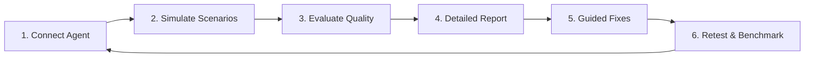
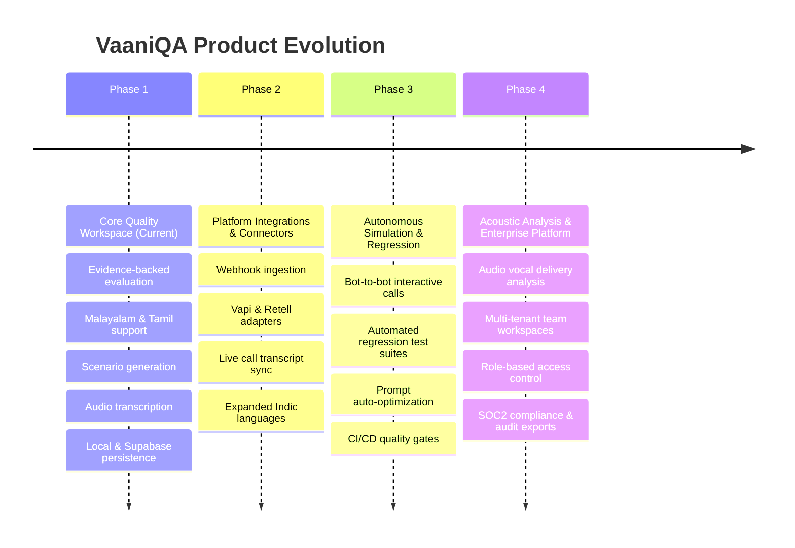

# VaaniQA — Voice Agent Quality Assurance & Continuous Improvement

> **A voice agent can give the correct answer and still deliver a bad conversation.**

VaaniQA is an AI-powered conversational quality assurance and continuous improvement platform designed for voice agents and customer-facing AI. While traditional testing checks functional correctness—whether an intent matched, an API was triggered, or an answer was returned—VaaniQA evaluates how naturally, appropriately, and contextually an agent communicates with real human beings.

---

## The Problem: Correctness Does Not Equal Quality

In modern enterprise voice applications, conventional automated testing stops at superficial validation:
- Did the speech-to-text engine catch the keywords?
- Did the dialogue model trigger the right function call?
- Was an answer returned without a 500 error?

Yet in real production deployments, conversations fail quietly and catastrophically for subtle human reasons:
- **Robotic, stilted phrasing:** The agent sounds like an automated IVR reading database rows rather than an empathetic, helpful representative.
- **Unnatural translation & code-switching:** In multilingual communities (such as Malayalam and Malayalam-English code-switching), literal translations produce archaic bookish vocabulary that native speakers would never use in everyday phone calls.
- **Tone mismatch:** Responding to an anxious caller with cold bureaucratic formality or dismissive repetition.
- **Contextual blindness:** Prematurely confirming commitments (e.g., confirming a doctor's appointment before checking clinic schedule availability) or failing to adapt when callers change their minds or provide incomplete details.
- **Conversational breakdown:** Inability to handle interruptions, clarifications, hesitation, or casual idioms.

VaaniQA bridges this gap by systematically evaluating conversations against real conversational dynamics, providing evidence-backed diagnoses, and driving a closed continuous improvement loop.

---

## Product Vision & Core Mission

VaaniQA's mission is to help teams build voice agents that talk like humans, respect cultural nuance, adhere to business boundaries, and continuously improve over time.

### The Continuous Improvement Loop



1. **Connect:** Integrate conversational AI systems, upload transcripts, or import recorded audio.
2. **Simulate:** Generate realistic, persona-driven edge cases and adversarial scenarios tailored to industry rules.
3. **Evaluate:** Assess multi-turn interactions across language naturalness, contextual judgment, business policy adherence, and conversational flow.
4. **Report:** Provide actionable diagnostic reports with exact transcript citations, uncertainty disclosures, and impact ratings.
5. **Improve:** Offer suggested rewrites, prompt adjustments, and rule clarifications that can be reviewed and approved by humans.
6. **Retest:** Convert past failures into automated regression suites to track quality metrics across releases.

---

## Comprehensive Quality Dimensions

VaaniQA evaluates conversational quality across multiple specialized dimensions. Below is the full evaluation framework and its current implementation status in the codebase:

| Quality Dimension | Description | Implementation Status |
| :--- | :--- | :--- |
| **Language Naturalness** | Does the response sound natural, fluent, and colloquial for everyday conversation? Avoids stilted grammar or machine-translated artifacts. | **Implemented** (Structured model assessment with transcript evidence matching) |
| **Contextual Judgment & Appropriateness** | Does the agent respond to what the user actually meant and asked? Checks policy timing (e.g., verifying availability before booking). | **Implemented** (Evidence-backed evaluation against expected rules) |
| **Suggested Alternatives** | Generates conversational rewrites preserving business intent while improving naturalness, with rationale. | **Implemented** (Validated against unsupported claims and malformed script) |
| **Uncertainty & Missing Evidence** | Explicitly declares evaluator uncertainty and flags missing contextual evidence (e.g. unstated clinic rules). | **Implemented** (Mandatory structured output fields) |
| **Conversational Tone & Register** | Evaluates if the agent is overly formal, repetitive, robotic, dismissive, or mismatched to user emotion. | **Partial** (Assessed within Naturalness/Context explanations; planned as dedicated score) |
| **Multi-Turn Flow & Direction Handling** | How the agent handles clarifications, topic changes, interruptions, and evolving customer requests. | **Partial** (Evaluates multi-turn inputs; automated live multi-turn execution is planned) |
| **Instruction & Rule Adherence** | Validates strict adherence to provided business boundaries without hallucinating advice or violating policy. | **Partial** (Evaluated against provided clinic context rules) |
| **Language & Code-Switching** | Handles mixed-language conversations (e.g. Malayalam-English), colloquial regionalisms, and script consistency. | **Partial** (Malayalam/Tamil locale constraints and code-switch heuristics active) |
| **Safety & Escalation** | Recognizes when to refuse, clarify, or hand off to human supervisors without fabricating unsafe guidance. | **Partial** (Escalation checks included in scenario generation and context evaluation) |
| **Vocal Delivery (Pace, Tone, Pauses)** | Measures acoustic qualities, speech cadence, hesitations, latency, and pronunciation from raw audio. | **Planned** (Audio files currently transcribe text only; vocal delivery is explicitly unevaluated) |

> **Transparency Note:** AI evaluations can make mistakes. VaaniQA enforces quotation of exact transcript snippets for all findings, marks unmeasured dimensions as unevaluated, and incorporates human review workflows to preserve reviewer disagreement and dialect variations.

---

## How It Works: Current Capabilities vs. Planned Vision

### 1. Realistic Human Conversation Simulation
Traditional testing relies on static, scripted question-and-answer trees. Real people do not converse like test scripts: they pause, correct themselves mid-sentence, ask follow-up questions, exhibit frustration, and introduce ambiguity.

- **Current Implementation:** VaaniQA generates structured scenario libraries across distinct categories (Appointment Scheduling, Service Inquiry, Rescheduling, Edge Cases, Out of Scope) using clinic constraints, operating hours, and business boundaries without hallucinating unverified medical guidance.
- **Long-Term Vision:** Dynamic multi-turn agent simulation where synthetic customer personas autonomously converse with live voice agents in real-time, adapting their responses based on the agent's behavior.

### 2. Connect Voice Agents & Chatbots
- **Current Implementation:** Users can test conversations via manual transcript paste, synthetic demo scenarios, browser-curated datasets, or by uploading call recordings (MP3, WAV, M4A, WebM up to 25 MB) for server-side Whisper transcription.
- **Long-Term Vision:** Native zero-code integrations and webhooks for leading voice platforms (Vapi, Retell AI, ElevenLabs, Bland AI) and universal conversational APIs to run automated end-to-end evaluation runs.

### 3. Detailed Quality Reports & Evidence
- **Current Implementation:** Interactive scorecards displaying overall quality scores (0–100), dimensional ratings, cited evidence quotes, rationale, uncertainty notes, and side-by-side original vs. suggested wording comparison with export support.
- **Long-Term Vision:** Longitudinal quality dashboards, regression test suites, team collaboration workspaces, downloadable PDF/audit reports, and cohort analysis across agent versions and locales.

### 4. Guided Fixes & Human-in-the-Loop Review
- **Current Implementation:** AI-generated wording suggestions with transparent review disclaimers. Reviewers can flag conversations for native-speaker evaluation, rate naturalness (1–5), specify dialect/register, and record human corrections.
- **Long-Term Vision:** Automated system prompt optimization, rule ambiguity detection, automated configuration change proposals, and verified native-speaker crowdsourcing networks.

---

## Regional Language & Multilingual Focus

Generic evaluation models routinely fail when assessing non-English conversations. VaaniQA prioritizes regional languages and vernacular dynamics, starting with **Malayalam (`ml-IN`)** and expanding to **Tamil (`ta-IN`)** and beyond:
- **Dialect & Register Sensitivity:** Avoids penalizing colloquial Malayalam or everyday Malayalam-English code-switching as "ungrammatical."
- **Anti-Hallucination & Script Hygiene:** Strict server-side Zod validation filters out corrupted Unicode, mixed-script artifacts, and unverified claims of "native-speaker approval."
- **Preserving Disagreement:** Human review modules record individual dialect annotations without artificially forcing consensus across regional variants.

---

## Target Industry Use Cases

| Industry | Typical Challenges | VaaniQA Quality Focus |
| :--- | :--- | :--- |
| **Healthcare & Clinics** | Appointment scheduling, pre-op instructions, department routing, triage. | Verifying policy compliance, preventing fabricated medical advice, ensuring clear escalation. |
| **Customer Support & Telecom** | Billing inquiries, plan changes, troubleshooting, complaints. | De-escalation tone, avoiding repetitive robotic scripts, handling customer frustration. |
| **E-Commerce & Logistics** | Order tracking, delivery rescheduling, return policy inquiries. | Clarity in explaining policies, managing multi-step clarifications, concise confirmations. |
| **Banking & Financial Services** | Balance checks, transaction inquiries, branch administrative info. | Strict safety boundaries, zero disclosure of private data, clear escalation paths. |
| **Education & Travel** | Admissions inquiries, ticket bookings, itinerary changes. | Handling complex multi-part questions and evolving customer intent. |

---

## Current Implementation Status

To ensure complete transparency for mentors, developers, and users, here is the verified status of the repository:

| Feature / Subsystem | Status | Details |
| :--- | :---: | :--- |
| **Interactive Test Lab UI** | **Implemented** | Full React workspace for evaluating transcripts, inspecting scores, and reviewing suggestions. |
| **Deterministic Demo Evaluator** | **Implemented** | Fast, local heuristic evaluation mode requiring no external API credentials. |
| **Live OpenAI Evaluator** | **Implemented** | Server-side structured evaluation (`gpt-4.1-mini`) with schema validation and evidence checks. |
| **Retry & Transient Failure Handling** | **Implemented** | Server automatically retries transient invalid provider outputs. |
| **Audio Upload & Transcription** | **Implemented** | Upload validation for MP3, WAV, M4A, WebM (≤ 25MB) with OpenAI transcription integration. |
| **Synthetic Scenario Generator** | **Implemented** | Generates unique clinic test suites across 5 categories based on configured business rules. |
| **Human Review Workflows** | **Implemented** | Flags results for native review; captures rating (1–5), dialect notes, and wording corrections. |
| **Dataset Browser & Privacy Redaction**| **Implemented** | Local repository managing authentic vs. synthetic records, checking obvious patient identifiers. |
| **Browser Local Storage Repository** | **Implemented** | Full local persistence for agent setups, scenarios, dataset records, and review feedback. |
| **Optional PostgreSQL/Supabase Adapter**| **Implemented** | Private schema with RLS, loopback-only endpoints, storing metadata without conversation transcripts. |
| **Live External Agent Connectors** | **Planned** | Direct API/webhook integration with Vapi, Retell, ElevenLabs (currently configuration labels only). |
| **Autonomous End-to-End Execution** | **Planned** | Simulating interactive phone calls directly into voice provider endpoints. |
| **Audio-Based Vocal Delivery Analysis**| **Planned** | Acoustic pitch, latency, pause, and jitter evaluation from raw audio signals. |
| **Automated Prompt Regression Testing**| **Planned** | Automated testing of new system prompts against past failure cases. |
| **User Authentication & Multi-Tenancy**| **Planned** | Currently a single-tenant local-first development workspace; no public multi-tenant auth. |

---

## Product Roadmap



- **Phase 1: Foundations (Current MVP)**
  - Local-first evaluation workspace and demo engine.
  - Server-side OpenAI structured evaluation with evidence enforcement.
  - Scenario generation with business constraints.
  - Human review logging for regional dialect nuances.
- **Phase 2: Platform Connectors (Near-Term)**
  - Ingestion webhooks for Vapi, Retell AI, and ElevenLabs.
  - Conversation import pipelines from CRM systems.
  - Expanded regional language packs (Hindi, Kannada, Telugu).
- **Phase 3: Autonomous Testing (Medium-Term)**
  - Persona-driven conversational agents testing voice agents autonomously.
  - CI/CD quality gates failing builds when conversational naturalness regresses.
  - Prompt and business-rule diff recommendations.
- **Phase 4: Multimodal Quality & Enterprise (Long-Term)**
  - Native audio acoustic analysis (pause frequency, interruptions, audio sentiment).
  - Multi-tenant enterprise workspaces with role-based access.
  - Verified human reviewer crowdsourcing marketplace.

---

## Proposed Monetization Model

*(Note: Pricing tiers below represent the proposed future business model. Live billing and paid quotas are not currently active in this repository.)*

| Tier | Target Audience | Planned Inclusions |
| :--- | :--- | :--- |
| **Free / Starter** | Developers, researchers, indie hackers | Community access, local evaluation tools, limited monthly test runs, basic quality reports, manual transcript paste. |
| **Pro** | AI voice engineers & boutique agencies | Higher evaluation volume, full scenario generation suite, conversation history comparisons, custom rule profiles, priority model evaluation. |
| **Team / Business** | Growing conversational AI teams | Shared workspaces, multi-agent management, regression testing suites, team human-review queues, webhook ingestion. |
| **Enterprise** | Healthcare systems, financial institutions, call centers | Custom voice-stack integrations, on-premise/VPC deployment, custom SLA, dedicated evaluation fine-tuning, security audits & HIPAA/SOC2 compliance. |

---

## Technology Stack

Verified directly from the repository:

- **Frontend:**
  - [React 19](file:///c:/Users/SINAN/OneDrive/Documents/VaaniQA/package.json) with TypeScript
  - [Vite 6](file:///c:/Users/SINAN/OneDrive/Documents/VaaniQA/vite.config.ts) bundling & development server
  - Vanilla CSS design system with custom typography, responsive grid layouts, and SVG data visualizations
  - Browser `localStorage` repositories for immediate, zero-setup local state
- **Backend Server:**
  - Node.js & [Express 5](file:///c:/Users/SINAN/OneDrive/Documents/VaaniQA/server/app.ts)
  - TypeScript execution with `tsx`
  - In-memory rate limiting and request payload validation
  - Strict input & output validation using [Zod](file:///c:/Users/SINAN/OneDrive/Documents/VaaniQA/server/evaluation.ts)
- **AI & Speech Providers:**
  - OpenAI Structured Outputs API (`OPENAI_MODEL`, defaults to `gpt-4.1-mini`)
  - OpenAI Whisper audio transcription adapter
  - Zero-data-retention headers (`store: false`) on provider calls
- **Data & Persistence:**
  - PostgreSQL driver (`pg`) for optional Supabase connection
  - Private database schema (`vaaniqa`) with Row Level Security (RLS) enabled
  - Strict privacy boundary: evaluation summaries store quality scores and finding categories, but intentionally exclude transcript text, quotes, and recordings
- **Testing & Quality Assurance:**
  - Node.js native test runner via `tsx --test`
  - 56 automated unit and integration tests across schemas, routes, locale handling, error states, and persistence

---

## Getting Started Locally

### Prerequisites
- Node.js 20+ installed
- npm 10+
- Optional: OpenAI API key (for live model evaluation, scenario generation, and audio transcription)
- Optional: Supabase PostgreSQL database (for remote persistence)

### Installation

1. **Clone the repository:**
   ```sh
   git clone https://github.com/Sinxn-coder/VaaniQA.git
   cd VaaniQA
   ```

2. **Install dependencies:**
   ```sh
   npm install
   ```

3. **Configure environment variables:**
   ```sh
   cp .env.example .env
   ```

   Edit `.env` with your preferred configuration:
   ```dotenv
   # Server-side only. Required for live evaluations, transcription, and scenario generation.
   OPENAI_API_KEY=your_openai_api_key_here

   # Evaluator model (default: gpt-4.1-mini)
   OPENAI_MODEL=gpt-4.1-mini

   # Port for the local server
   PORT=3000

   # Optional: Supabase Shared Pooler PostgreSQL connection (port 5432, sslmode=require)
   # Leave blank to use browser-local storage.
   DATABASE_URL=
   ```

4. **Start the development server:**
   ```sh
   npm run dev
   ```

   Open your browser at:
   ```text
   http://localhost:3000/
   ```

---

## Development Scripts

```sh
# Start local development server with live reload
npm run dev

# Run automated test suite (56 tests)
npm test

# Type-check and build production artifacts
npm run build

# Start production server
npm start

# Preview production client build
npm run preview
```

---

## API & Integration Seams

The server exposes structured endpoints for evaluation and workspace management:

### `POST /api/evaluations`
Evaluates a conversation transcript against expected behavior.
```json
{
  "conversation": "Caller: വെള്ളിയാഴ്ച അപ്പോയിന്റ്മെന്റ് ഉണ്ടോ?\\nAgent: അതെ, രാവിലെ 10 മണി ലഭ്യമാണ്.",
  "expectedBehavior": "Verify schedule availability before confirming booking.",
  "language": "Malayalam",
  "locale": "ml-IN"
}
```

### `POST /api/scenarios/generate`
Generates a structured synthetic scenario library based on agent configuration and clinic rules.

### `POST /api/transcriptions`
Accepts multipart/binary audio streams (`.mp3`, `.wav`, `.m4a`, `.webm` up to 25 MB) and returns text transcription via Whisper.

### `GET /api/persistence/status`
Returns whether persistence is running in `local` (browser storage) or `supabase` mode. Persistence endpoints are restricted to same-origin loopback requests for development security.

---

## Privacy, Security & Responsible AI

- **No Public API Exposure:** The server is configured for local development and loopback requests; it does not implement public multi-tenant authentication.
- **Data Minimization:** Provider API calls specify `store: false`. Evaluation persistence schemas intentionally omit raw transcript bodies and customer identifiers.
- **Identifier Redaction:** The dataset repository checks for common medical record, phone, and identity patterns before allowing record import.
- **Never Upload Confidential Data:** Do not upload unconsented customer phone recordings, patient identifiers, or private data to public model providers.

---

## Contributing & License

Contributions, feedback, and discussion on voice-agent quality assurance are warmly welcomed. Please open an issue or pull request to discuss ideas.

This repository is currently maintained as an open prototype and evaluation platform under the project's root repository configuration. Consult the team before commercial production deployment.

---

**VaaniQA — Built for every voice.**
Repository: [https://github.com/Sinxn-coder/VaaniQA](https://github.com/Sinxn-coder/VaaniQA)
